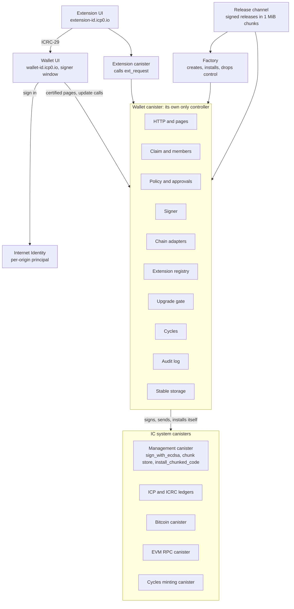

# System design

Draft 0, 2026-10-20.

Each wallet is one canister that serves its own UI, keeps its accounts and
policy, signs with chain-key, and is its own only controller. No developer,
factory or DAO can change it afterwards: it upgrades itself, and only to a
release its owners approved, after a delay that lets them leave first.

## What the spikes proved

On a local network (icp-cli 1.2.0, ic-cdk 0.20.3), 2026-10-19 and 2026-10-20:

- React 19.2 `renderToString` runs inside a plain Rust canister on the Boa 0.22
  JavaScript engine, byte-identical to Node's output, at about 32M instructions
  per KB of HTML.
- Pages rendered in an update call and certified with `ic-http-certification`
  4.0.0 pass the verifying gateway; serving one costs 3.6M to 4.1M instructions.
- QuickJS (quickjs-ng 0.16.2, through `rquickjs` 0.14.0) renders the same page,
  also byte-identical, at about 9M instructions per KB of HTML, in a Wasm of
  595 KB gzipped.
- A canister can make itself its only controller, which locks out the deployer.
- A self `install_code` sent one-way upgrades cleanly from v1 to v2 to v3. An
  awaited one lands but traps on the reply (IC0502).
- Threshold ECDSA keys per derivation path work, and their signatures verify
  offline.

At step 11 the wallet upgrades itself on PocketIC from v1 to v2 to v3 with
its own Wasm, over the 2 MB message limit, staged as four 1 MiB chunks in its
chunk store. Not proved yet: that self-upgrade on mainnet, and cycle costs
there. The wallet's Wasm has been over that limit since step 7; at step 11 it
is 3.93 MB, or 934 KB gzipped (`gzip -9`), and the IC accepts a gzipped module
under that limit. The wallet builds secp256k1 with
its `lowmemory` tables: the default ones made it 4.78 MB, or 1.97 MB
gzipped, since precomputed points do not compress. About 410 KB of its code
is the glob matcher (`globset` and its regex engine) that
`ic-asset-certification` always pulls in.

At step 12 a factory creates wallets on PocketIC, with the IC's cycles
minting canister and cycles ledger. Of 3T cycles a creator pays, a new wallet
starts with 2.49T; the rest paid the IC for creating the canister and
installing the release. The factory spends about 8.5B cycles of its own per
wallet on its calls. Not proved yet: the same on mainnet.

The wallet itself runs no JavaScript: its pages are prerendered at build and
embedded in the release ([decision 0001](decisions/0001-react-rendering.md)).
The rendering results above apply to public pages served by a separate
canister.

## Architecture



The browser reaches the wallet only through certified pages and update calls on
the wallet's own domain. Extensions, the release channel and the factory are
separate canisters that can ask, offer or create, but never control the wallet.

## Firmware modules

Only the chain adapters, the signer and the upgrade gate can move funds or
change code, and they act only on actions the policy module released.

| Module | What it owns | Calls out to |
| --- | --- | --- |
| HTTP and pages | `http_request` for the prerendered pages and browser bundle embedded in the release, certified in `init` and `post_upgrade`; the certified 404; CSP and frame headers | Certification tree, `certified_data_set` |
| Claim and members | One-time claim with the claim key; members with roles Owner, Approver, Viewer, Proposer; the guards that refuse a caller before its arguments are decoded | None |
| Policy and approvals | Rules per action kind: quorum, daily limits, timelocks; the pending-action queue | Members |
| Signer | Addresses and signatures by derivation path: threshold ECDSA (secp256k1) for Bitcoin and EVM, threshold Schnorr later | Management canister |
| Chain adapters | ICP and ICRC tokens held by the canister's own principal and subaccounts; Bitcoin through the Bitcoin canister; EVM through the EVM RPC canister | Ledgers, Bitcoin canister, EVM RPC canister |
| Extension registry | Installed extensions, their origins, permissions, budgets and sub-wallet paths; the `ext_request` entry point | Extension canisters |
| Upgrade gate | Verifies a release manifest, stages its chunks in the canister's own chunk store, enforces approval and timelock, installs one-way, checks the module hash afterwards | Release channel, management canister |
| Cycles | Balance, freezing threshold, low-balance warning, top-ups | Cycles minting canister |
| Audit log | Append-only record of every privileged action | None |
| Stable storage | All state in stable structures; the certification tree is rebuilt from the embedded pages in `post_upgrade` | None |

## Key flows

Every flow that moves funds or changes code ends in the same place: a pending
action that the policy module releases only after its quorum and timelock.

### Create and claim

1. The creator's browser makes a fresh Ed25519 claim keypair. Only the public
   key leaves the browser.
2. The creator lets the factory take the wallet's cycles and the fee from
   their account on the cycles ledger, and calls the factory's
   `create_wallet` with that public key, when the claim expires, and the
   cycles. The factory first checks that two of the three signer keys signed
   the channel's release. The cycles ledger then takes the cycles and has the
   cycles minting canister create the canister (`create_canister_from`),
   controlled by the factory alone. The factory stages the release's chunks
   in the canister's own chunk store, each checked against the signed
   manifest, installs the wallet with `InitArgs` that name the channel, the
   signer keys and the factory, empties the chunk store, and makes the wallet
   its own only controller. If the release does not install, the creator
   becomes the canister's only controller instead, with the cycles left in
   it. A canister whose hand-over fails stays on the factory's record, and
   the factory's timer tries again every five minutes until it controls none
   of the canisters it created.
3. The browser builds the claim link
   `https://<wallet id>.icp0.io/claim#<claim key>`, where the claim key is the
   private key's 32-byte Ed25519 seed in base64url, without padding. The
   fragment never reaches the gateway or any node.
4. The future owner opens the link. The claim page reads the key once and
   takes the fragment out of the address bar and the history. The owner signs
   in with Internet Identity, which returns the principal for that domain.
5. The page signs `claim:<wallet id>:<caller principal>` with the claim key
   and calls `claim`; only the signature leaves the browser.
6. The wallet checks the signature, the expiry, and that the signed principal is
   the caller. It adds the caller as Owner, deletes the claim key and logs the
   claim. A copied signature is useless to anyone else, because it names the
   caller.
7. Until it is claimed, the wallet answers only `claim`, `status` and
   `http_request`.

### Sign in and add principals

1. Members sign in with II on the wallet's domain. The II derivation origin is
   pinned to `https://<wallet id>.icp0.io`, so a custom domain added later
   yields the same principals.
2. A new device or anchor signs in, is not a member yet, and calls
   `request_join` with a label. The wallet creates a pending `AddMember` action
   that adds it as a viewer, or as a proposer when it asks for that role,
   open for an hour, and the page shows a short code
   on both screens: eight digits from the SHA-256 of the new principal's
   text. At most eight join requests are open at once, counted apart from the
   members' proposals.
3. An owner checks the code and approves. Removing an owner needs the other
   owners' quorum and a timelock, so one stolen device cannot lock the others
   out.

### Approve an action

1. Owners propose and reject; owners and approvers approve and execute;
   viewers only read. A proposer, such as an AI agent, reads and proposes
   transfers and nothing else, at most 8 open at once
   ([decision 0007](decisions/0007-agent-proposer.md)). The approval of an
   owner who proposes counts toward the quorum; a proposer's never does.
2. An action waits seven days for its quorum. Once it has it, the timelock of
   its rule starts, and it can be executed from then until seven days after
   the timelock ends. Past either window it is expired.
3. The quorum and timelock are fixed when the action is proposed. An approval
   stops counting while the action waits if its member is removed or becomes
   a viewer.
4. `execute` checks the action again against the current members and policy;
   one that no longer fits ends `Failed` with the reason.
5. The claim, each join request, proposal, approval, rejection and
   execution writes one audit entry, in the same message as the change; a
   refused call or a repeated approval writes none. An expiry is no one's act
   and is not logged: the action shows it.
6. No change may leave the wallet without an owner, or with fewer owners and
   approvers than a rule's quorum. The `SetPolicy` rule needs at least the
   quorum and timelock of every other rule, so changing the policy is never
   the shortcut around a rule.

### Send a transfer

1. Every wallet has account 0 of each kind ([decision
   0008](decisions/0008-account-kinds.md)); an owner adds more with
   `add_account`: a kind and a label. It needs no approval, since it moves
   nothing, and a wallet has at most 64 accounts. An Internet Computer
   account is an ICRC-1 account of the wallet's own principal and holds ICP
   and every ICRC-1 token the owners track: index `n` is subaccount `n` as
   32 big-endian bytes, so index 0 is the plain principal ([decision
   0002](decisions/0002-subaccounts.md)). The wallet reaches the ICP ledger
   through its ICRC-1 interface, and an `Icrc` asset never names it, so ICP
   tokens have one daily limit. A Bitcoin account holds its coins at the
   P2WPKH address of the threshold ECDSA key of path
   `wallet / bitcoin-<network> / n`, with `n` as 4 big-endian bytes;
   `add_account` asks the management canister for that key. `balance` asks
   the token's ledger, or the Bitcoin canister for the satoshis in outputs
   with at least one confirmation, less those a sent transaction spends and
   plus its change.
2. An owner or a proposer calls `propose` with a `Transfer`. A chain's spending is what it
   sent in the last 24 hours plus what its open transfers under the daily
   limit may still send. An owner's transfer that keeps it within the limit
   is released at once; above it, the action waits for approvals and its
   timelock. A proposer's transfer always waits for one approval. Under a Transfer rule of one approval and no timelock, the limit
   changes nothing.
3. Approvers call `approve` from their own devices; any owner can `reject`.
4. On `execute` the chain adapter sends it, with one ledger or Bitcoin call at
   a time. A transfer under the daily limit is checked against it again
   first. A Bitcoin transfer's fee counts toward the limit; a ledger's fee
   does not.
5. ICP and ICRC tokens move by `icrc1_transfer` from the account's
   subaccount, in a bounded-wait call with a `created_at_time` that no other
   call has, so two identical transfers executed together are both sent.
   When the wallet cannot tell whether a call ran (it timed out, its answer
   does not decode, or the wallet's code after it trapped), the action stays
   ready and cannot be rejected, and the wallet's timer makes the call again
   every 10 minutes, as does any `execute`, with that `created_at_time`: the
   ledger then answers with the earlier block instead of sending again.
   Ledgers find a repeated transfer for 24 hours, so the action stays open
   until 24 hours after that call. The wallet counts a call as not run only
   when the IC rejected it before the ledger ran it;
   a reject from the ledger itself, a stopped ledger's included, may follow
   a committed transfer, so it leaves the outcome unknown. A refusal by the
   ledger (too little in the account, a wrong fee) ends the action `Failed`,
   unless an earlier call may have run: a ledger checks the fee before it
   looks for a repeat, so then the action stays ready.
6. A Bitcoin transfer is built once, on its first `execute`: it spends the
   account's confirmed outputs that no other open transfer has reserved,
   those with 100 confirmations first and then the largest first ([decision
   0003](decisions/0003-young-bitcoin-outputs.md)), pays the recipient in
   its first output and the change back to the account in its second, and
   pays either the proposer's whole fee or the median rate of recent
   transactions (at least 1 sat/vB; 2 sat/vB when the Bitcoin canister
   offers none). Its outputs are reserved for the action, a transfer under
   the daily limit is checked against it again with the real fee, and again
   just before each send until one may have reached the Bitcoin canister, so
   a policy that changed while it was signed applies. Every later `execute`
   sends that same transaction, signing it first if it is not signed yet, so
   it cannot pay twice. Each input is signed with threshold ECDSA in a
   bounded-wait call, and each signature is checked before the transaction
   goes to the Bitcoin canister. Once it may have reached the Bitcoin
   canister, the action stays ready, cannot be rejected and never expires:
   `execute` sends the same transaction again until the Bitcoin canister
   accepts it. The wallet's timer then watches the account's outputs: while
   the transaction's inputs are unspent it sends the transaction again an
   hour after the last send, then two hours, and so on up to once a day, and
   once they have been spent for 6 blocks it releases them. A transfer that
   ends without sending releases its outputs. Change is spendable only once
   it confirms. EVM transactions follow in v1.
7. The page shows the new balance and history from calls the agent verifies;
   the canister renders nothing.

### Install and use an extension

1. An owner enters an extension canister id. The wallet reads its manifest:
   name, origin, requested permissions.
2. The wallet's own page shows those permissions and a budget per chain.
   Installing is an `InstallExtension` action under the policy.
3. The wallet records the extension's origin, permissions, budget and sub-wallet
   path `ext / extension id / chain / index`.
4. The extension's UI runs only on its own origin. It reaches the wallet by
   opening the wallet's `/signer` window (ICRC-25 and ICRC-29 over
   `postMessage`); the window answers only registered origins and shows an
   ICRC-21 consent message for every call.
5. The extension's canister can also call `ext_request` directly. The wallet
   checks that the caller is that extension's canister, the permission and the
   remaining budget, then signs with the extension's sub-wallet key only.
6. Uninstalling revokes the permissions. Funds left in the sub-wallet stay
   under the owners' control.

### Publish a release

Three keys sign releases, and a release needs any two of them ([decision
0004](decisions/0004-release-signers.md)). The release channel is a canister
of its own, installed with its publishers, the signer keys and the threshold;
an upgrade keeps them or replaces them.

1. A publisher builds the Wasm and runs `release-tool manifest`, which cuts it
   into 1 MiB chunks and writes the manifest: version, Wasm SHA-256 and size,
   one SHA-256 per chunk, the module hashes it was tested to upgrade from, the
   notes URL and the publish time.
2. Two signers each check the manifest against the Wasm and run
   `release-tool sign`, which signs SHA-256 of the manifest's Candid encoding
   with no signatures.
3. The publisher stages every chunk with `publish_chunk`. A chunk staged again
   replaces the one before.
4. `publish_manifest` checks the manifest's form, that its version is new,
   that two of the channel's keys signed it, and that every staged chunk
   matches its hash and all of them together are the Wasm it names. Only then
   does the release go live, with its chunks; until then the channel serves
   nothing of it.
5. A published version never changes. Wallets read `latest`, `manifest` and
   `chunk`, and check all of it again against the keys they pin, so the
   channel can withhold a release but cannot push a bad one.

Only publishers can call `publish_chunk` and `publish_manifest`. The channel
drops anyone else's message before it runs, so a stranger's megabyte costs it
no cycles, and its guard refuses a call from another canister. Checking the
largest release, 100 chunks, which is what the IC's chunk store holds, hashes
every byte twice in one call: about 16.4 billion of the 40 billion
instructions an update may use.

### Self-upgrade

1. The release channel publishes a manifest: version, Wasm SHA-256, chunk
   hashes, the module hashes it was tested to upgrade from, and signatures from
   the release signers.
2. A member asks `release_available`. The wallet asks the channel for its
   latest release and returns it only when the signatures meet the threshold
   of the signer keys pinned in the wallet, and when its own module hash, read
   with `canister_info`, is in the tested list. Nothing checks on a schedule:
   a member asks from the start page, with Check for a new version.
3. An owner proposes `Upgrade` with the version and its Wasm SHA-256. After the
   quorum the timelock starts; the page shows a banner and any owner can
   reject.
4. After the timelock, `execute` checks the manifest again as in step 2, and
   that the wallet is its own controller, which the install needs. It checks
   that it can spend what staging and installing cost, above what it keeps to
   stay running: the IC holds back what the install's instruction limit would
   cost, about 0.3T cycles on a 13-node subnet, and refuses an install the
   canister cannot pay for. If it cannot, the execution stops with
   `InsufficientCycles`, which says how many cycles the wallet can spend and
   needs, and the action stays ready for after a top-up. It then fetches each
   chunk, checks its hash, and calls `upload_chunk` on the wallet's own chunk
   store. A failed call stops the execution and keeps the chunks staged so far,
   and executing again goes on from there. A release that fails a check ends
   the action `Failed`.
5. Once every chunk is staged, no call of the wallet waits for its answer, and
   the wallet can still pay for the install, it saves `Installing` with the
   expected hash and a deadline an hour away, then sends `install_chunked_code`
   to itself one-way in the same message. An awaited call would trap on the
   reply, and the reply to any call still in flight would reach the new
   version's code. So while it is `Installing` the wallet makes no call but
   the install, and refuses to execute actions and the methods that call out.
6. The new version's `post_upgrade` marks the upgrade done and ends its action
   `Executed`; a timer then clears the chunk store. If the install failed, the
   new version's `post_upgrade` trapped or the IC refused it, and the old code
   is still running. The IC refuses an install for a few seconds after another
   one on the same canister, and the one-way call never hears it, so the old
   version's timer sends the install again 1, 3, 7, 15 and 31 minutes after the
   first send; if the first had only not run yet, the new version installs
   again and finds the upgrade done. At the deadline the old version's timer,
   or the next `execute`, marks the upgrade and its action `Failed` and clears
   the chunk store. An install that landed after its deadline would run with
   the upgrade marked `Failed`; the module hash `canister_info` reports tells
   which version runs.

### Serve a page

1. `init` and `post_upgrade` certify the files embedded in the release with
   `ic-asset-certification` and set the canister's certified data to their
   root hash. The certification tree lives on the heap only.
2. `/` and `/index.html` are the start page; `/send`, `/receive`,
   `/approvals`, `/settings`, `/members` and `/claim` the send, receive,
   approvals, settings, members and claim pages, each also at its `.html`
   path; and `/app.js` and `/app.css` the app's
   script and styles. Any other path is the 404 page with status 404,
   certified as the fallback for `/`.
3. Every page carries these headers, all certified: the Content-Security-Policy
   below, `x-content-type-options: nosniff`, `x-frame-options: DENY`,
   `referrer-policy: no-referrer`,
   `strict-transport-security: max-age=31536000; includeSubDomains`, and
   `cache-control: no-cache`.
4. `http_request` answers only as a query. A URL whose path cannot be decoded
   gets a 400 without a certificate, which a gateway refuses to show.

The Content-Security-Policy, pinned by a test:

```text
default-src 'none'; script-src 'self'; style-src 'self'; img-src 'self' data:;
font-src 'self'; connect-src 'self' https://icp-api.io https://icp0.io;
frame-src 'none'; frame-ancestors 'none'; object-src 'none'; base-uri 'none';
form-action 'none'; upgrade-insecure-requests
```

The files come from `ui/`, a React app built with a pinned Node, esbuild and
lockfile ([decision 0006](decisions/0006-client-library.md) chose its client
library). The build renders each page to HTML in Node, with what is the same
for every visitor, and bundles the app that hydrates it; the HTML holds no
inline script or style and loads only `/app.js` and `/app.css`. In the
browser, the app works only at the wallet's own address
(`https://<wallet id>.icp0.io`, or `http://<wallet id>.localhost` on
icp-cli's network), takes the wallet's id from it, and fills in everything
else from calls to the wallet. It makes its reads as replicated calls, which
the subnet certifies, rather than as queries a single replica answers, and
reads a token's symbol, decimals and fee from its ledger's `icrc1_metadata`
the same way. The start page shows a member the wallet's holdings per
token, its accounts with their balances, its open actions, cycles and
version, and its newest audit entries, with a notice for every open action
that is not a transfer, since those change who controls the wallet or what
it runs, and one when it runs low on cycles; it lets an owner add an
account, and asks to join for someone signed in who is not a member. The
send page proposes a transfer and runs it when the policy lets it through at
once; the receive page shows each account's whole address and its QR code to
give a sender ([decision 0009](decisions/0009-qr-encoder.md)); the approvals
page lists the open actions with the buttons the member's role allows. The
settings page holds the rest: the members, a security checkup with the
policy, what the IC's certified state says of the wallet's controllers and
module hash, and the session; its members page lets an owner propose adding,
removing or changing the role of a member, refusing first what the wallet
would refuse. CI
builds the files twice, the second time from a clean copy in another
directory, and checks that both builds and the committed files are the same
bytes.

## Data model

All state lives in stable memory, one virtual memory per store
(`ic-stable-structures`), so an upgrade never serializes the heap. A memory id
is never reused or renumbered, even after its store goes away; the audit log's
`StableLog` takes two, its index and its data.

| Memory id | Store | Key to value | Structure | On upgrade |
| --- | --- | --- | --- | --- |
| 0 | Config | claim key until claimed, release channel, release signer keys and threshold, factory | `StableCell` | Kept |
| 1 | Policy | action kind to quorum, daily limit, timelock | `StableCell` | Kept; changed only by a `SetPolicy` action |
| 2 | Members | principal to role, label, added at, added by | `StableBTreeMap` | Kept |
| 3 | Accounts | account id to kind, label, derivation index, holder, added at and by, a Bitcoin account's public key, and the account an ICP or ICRC account became when accounts got kinds; never deleted | `StableBTreeMap` | Kept; addresses derived from the index or the key |
| 4 | Pending actions | action id to action, approvals, earliest execution, state, and a Bitcoin transfer's transaction, whether it may have been sent, how often and when it was last sent, and from which block its inputs were spent; never deleted, so an id never names another action | `StableBTreeMap` | Kept; timelocks keep running |
| 5 | Extensions | extension canister id to origin, permissions, budgets, spent this window | `StableBTreeMap` | Kept |
| 6 | History | sequence to a transfer the wallet sent: account, chain, recipient, amount, ledger block or Bitcoin txid, Bitcoin fee, action | `StableBTreeMap` | Kept; the daily limit reads its last 24 hours |
| 7 and 8 | Audit log | sequence to entry | `StableLog` | Kept, append-only |
| 9 | Upgrade state | idle, staging, installing or failed; the action, its manifest and the execution in flight | `StableCell` | Read in `post_upgrade`, which ends the install |
| 10 | Open actions | the ids of the pending actions still waiting or ready | `StableBTreeMap` | Kept |
| 11 | Transfer clock | the latest `created_at_time` given to a ledger call | `StableCell` | Kept |
| 12 | Reserved Bitcoin outputs | an outpoint to the transfer whose transaction spends it; released if that transfer ends unsent, or once its transaction has spent it for 6 blocks | `StableBTreeMap` | Kept |
| 13 | Tracked assets | the assets the accounts show and send: ICP, then the ICRC-1 ledgers the owners track | `StableCell` | Kept |
| 14 | Unsettled transfers | the ids of the transfers whose outcome the timer still settles | `StableBTreeMap` | Kept |

Every stored value is Candid with optional new fields, so a release can add
fields without a migration. A store a release adds is filled in by
`post_upgrade` first: a wallet from before the policy store gets the default
policy, and one from before the audit log starts an empty log, so its log
begins at that upgrade. One from before step 8 starts with no accounts and no
history. One from before account kinds gives each account its kind: ICP and
ICRC accounts with the same index were one subaccount, so they become one
Internet Computer account under the oldest id, the ICRC-1 ledgers they held
become tracked, and each transfer names the asset it sends. `post_upgrade`
then decodes every stored value before it returns, so a release that cannot
read the state traps there and the IC keeps the running version. CI installs the pull request's base, claims it and
upgrades it to the change. Pages are not state: they are embedded in the
Wasm, so they change only with a release. The heap holds only the
certification tree, rebuilt from them in `post_upgrade`.

The release channel keeps its state the same way, and its `post_upgrade` reads
its configuration and every manifest before it returns:

| Memory id | Store | Key to value | Structure |
| --- | --- | --- | --- |
| 0 | Config | publishers, release signer keys and threshold | `StableCell` |
| 1 | Releases | version to its manifest, once published | `StableBTreeMap` |
| 2 | Publish order | sequence to version; `latest` is the last | `StableBTreeMap` |
| 3 | Chunks | version and index to the chunk's bytes, staged or published | `StableBTreeMap` |

So does the factory, whose `post_upgrade` also sets its timer again while a
canister waits for its hand-over:

| Memory id | Store | Key to value | Structure |
| --- | --- | --- | --- |
| 0 | Config | release channel, release signer keys and threshold | `StableCell` |
| 1 | Hand-overs | a canister it created and still controls to its creator, the module of its release, and when it was created | `StableBTreeMap` |

## Schema

The target interfaces are in [`candid/`](../candid):

| File | Canister | Methods |
| --- | --- | --- |
| `wallet.did` | Wallet firmware, one per wallet | 26 |
| `release_channel.did` | Release channel, one per publisher | 6 |
| `factory.did` | Factory, shared | 2 |
| `extension.did` | Every extension canister | 1 |
| `common.did`, `icrc21.did` | Shared types; ICRC-21 copied from the standard | none |

## Security model

The largest risk is the upgrade path, not the key: the threshold key never
exists in canister memory, but whoever can install code can move every fund.

| Threat | Mitigation | What remains |
| --- | --- | --- |
| A malicious or compromised release | Two of three release signer keys, pinned in the wallet; owner quorum; timelock with a banner during which any owner can cancel or withdraw | Owners who ignore the banner; two signers who sign a bad release |
| A compromised release channel or publisher | The channel publishes only a manifest two signers signed, with chunks that match it; wallets check both again themselves | It can withhold releases |
| A malicious or compromised factory | It installs only a release two of the three signer keys signed, pins those keys in the wallet, and leaves each wallet its own only controller; a wallet's module hash and controllers are public in the IC's certified state | A factory whose controllers change its code can create wallets that run other code or that it still controls, and nothing checks a new wallet's module hash and controllers before the claim yet. Wallets already handed over are out of its reach |
| Strangers calling the factory | `create_wallet` checks its arguments and the release before the creator pays; the creator pays the wallet's cycles | Each call costs the factory cycles: a refused one a channel read and the signature checks, and each wallet about 8.5B for the factory's calls, which the creator does not pay |
| An upgrade that bricks the wallet | One-way install keeps the old code when `post_upgrade` traps, the wallet sends an install the IC refused again, and marks the upgrade `Failed` an hour later; an upgrade the wallet cannot pay for stops before it stages; `tested_from` refuses untested paths; every release is tested over the last two versions | No rescue if a release breaks its own upgrade method ([decision 0005](decisions/0005-rescue-path.md)) |
| An AI agent that is misled or compromised | It joins as a proposer: it reads and proposes only transfers, its approval never counts, so each transfer waits for an owner or an approver; at most 8 of its actions are open at once; its MCP server runs on its user's computer with a key file only that user can read, and offers no tool that approves, runs or rejects ([decision 0007](decisions/0007-agent-proposer.md)) | An owner who approves what the agent proposes without reading it; what the agent can read: balances, the audit log and members |
| One owner's device or anchor stolen | Quorum and timelock above the daily limit; any owner can reject; removing an owner needs the others | Losses up to the daily limit |
| Claim link intercepted | Private key only in the fragment; one use; expiry; the signature names the caller | Whoever opens the link first owns the wallet |
| Injected script or phishing on the wallet's page | Every byte certified; no third-party scripts; CSP `script-src 'self'`, `frame-src 'none'`, `frame-ancestors 'none'`; the UI is prerendered at build and ships inside the signed release, with no per-user data in HTML | Look-alike domains; the browser trusts the HTTP gateway to verify the page |
| A malicious extension | Own canister and origin, never rendered by the firmware; own sub-wallet path and daily budget; signer window answers only registered origins; ICRC-21 consent for every call | Funds inside its own budget |
| Strangers calling the wallet | Before the claim only `claim`, `status` and `http_request` answer; after it, also `whoami` and `request_join`. Every other method has a guard that rejects the call before its arguments are decoded unless the caller is a member (for `ext_request`, a registered extension) | Rejected update calls still cost the wallet cycles. Join requests are stored for good, but at most eight are open at once and each for an hour, so strangers add at most about 200 a day |
| A dishonest replica answering a query | Every action and balance is an update call; pages are certified; the UI makes its reads as replicated calls, which the subnet certifies | Other clients that read member lists and history by query |
| Node operators reading state | Keys are threshold keys held by the subnet; private notes and labels encrypted with vetKeys | Plaintext state stays readable without SEV |
| A ledger call whose outcome the wallet never learns | Every retry reuses the call's `created_at_time`, so the ledger answers with the earlier block; the action stays open, and cannot be rejected, while the ledger can still find it, and the timer retries every 10 minutes | A ledger that answers none of the retries for 24 hours leaves the transfer unknown to the wallet; the ledger holds the answer |
| A Bitcoin send whose outcome the wallet never learns, or that the network drops | The transaction is built and signed once and stored; every retry sends the same one, whose id no signature changes, and its outputs stay reserved; the action stays open and cannot be rejected; the timer sends it again while its inputs are unspent, up to once a day, and releases them only once they have been spent for 6 blocks | A transaction the network never takes keeps its outputs reserved |
| A mining reward spent before it matures | Outputs with 100 confirmations are spent first, then the largest; the Bitcoin canister lists a mining reward from its first confirmation and does not mark it as one; the timer sends a transaction whose inputs stay unspent again | A transfer that needs a reward younger than 100 blocks reads `Executed` before the network takes it, and reaches it on a later send once the reward matures. Only accounts paid straight from a block can hit this |
| A broken or hostile ledger named by an owner | Ledger calls wait a bounded time, so no ledger can keep the wallet from stopping or upgrading; a ledger is asked only about its own token | It can report any balance or block for its own token |
| Cycles running out | Long freezing threshold; low-balance banner and audit event; anyone can top up | A wallet nobody tops up is deleted |
| Custom domain taken over | II derivation origin pinned to the `icp0.io` domain; a custom domain is only an alias | Users who sign in on a fake alias |

## Open decisions

| Decision | Options | Recommendation |
| --- | --- | --- |
| Upgrade timelock | 48 hours; 7 days | 7 days for upgrades, 24 hours for removing an owner; the default policy uses this, with 24 hours for role changes and 7 days for `SetPolicy` |
| Default quorum | 1 while there is one owner; 2 once a second owner joins | Start at 1, prompt to raise it when a second owner joins; the default policy starts at 1 |
| Chains in v0 | ICP and ICRC only; add Bitcoin; add EVM | ICP, ICRC and Bitcoin; EVM in v1 |
| Fee model | Owners top up cycles; a per-signature fee in tokens | Owners top up in v0 |
| Custom domains | `icp0.io` only; custom domains as aliases | `icp0.io` only in v0 |

## Milestones

| Version | Scope | Gate to the next |
| --- | --- | --- |
| v0 | One owner on mainnet: factory, claim link, II sign-in; ICP, ICRC and Bitcoin accounts; transfers; certified pages; signed releases by chunked self-upgrade | Chunked self-upgrade passes from v(n) to v(n+2) on mainnet; cycle costs measured |
| v1 | Shared wallet: several principals, join requests, quorum and timelocks per action; audit log; EVM accounts | An external review of the policy module and the upgrade gate |
| v2 | Extensions: registry, sub-wallet keys, daily budgets, `ext_request`; signer window over ICRC-25 and ICRC-29 with ICRC-21 consent | Adversarial tests show no extension can spend past its budget |
| v3 | Framework: the firmware core published for any self-owned app; render on write for public pages, in a separate canister on its own origin; vetKeys for private data; custom domains as aliases | None |
