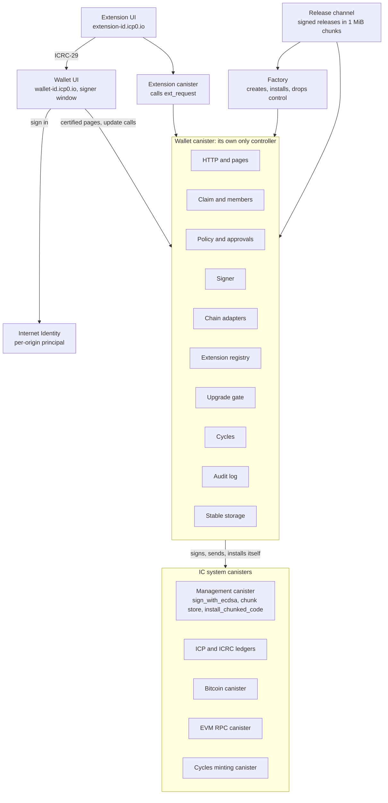

# System design

Draft 0, 2026-10-20.

Each wallet is one canister that serves its own UI, keeps its accounts and
policy, signs with chain-key, and is its own only controller. No developer,
factory or DAO can change it afterwards: it upgrades itself, and only to a
release its owners approved, after a delay that lets them leave first.

## What the spikes proved

On a local network (icp-cli 1.2.0, ic-cdk 0.20.3), 2026-10-19 and 2026-10-20:

- React 19.2 `renderToString` runs inside a plain Rust canister on the Boa 0.22
  JavaScript engine, byte-identical to Node's output, at about 32M instructions
  per KB of HTML.
- Pages rendered in an update call and certified with `ic-http-certification`
  4.0.0 pass the verifying gateway; serving one costs 3.6M to 4.1M instructions.
- QuickJS (quickjs-ng 0.16.2, through `rquickjs` 0.14.0) renders the same page,
  also byte-identical, at about 9M instructions per KB of HTML, in a Wasm of
  595 KB gzipped.
- A canister can make itself its only controller, which locks out the deployer.
- A self `install_code` sent one-way upgrades cleanly from v1 to v2 to v3. An
  awaited one lands but traps on the reply (IC0502).
- Threshold ECDSA keys per derivation path work, and their signatures verify
  offline.

Not proved yet: a chunked self-upgrade for a Wasm over the 2 MB message limit,
and cycle costs on mainnet. The wallet's Wasm has been over that limit since
step 7; at step 8 it is 3.10 MB, or 715 KB gzipped (`gzip -9`), and the IC
accepts a gzipped module. About 410 KB of its code is the glob matcher
(`globset` and its regex engine) that `ic-asset-certification` always pulls
in.

The wallet itself runs no JavaScript: its pages are prerendered at build and
embedded in the release ([decision 0001](decisions/0001-react-rendering.md)).
The rendering results above apply to public pages served by a separate
canister.

## Architecture



The browser reaches the wallet only through certified pages and update calls on
the wallet's own domain. Extensions, the release channel and the factory are
separate canisters that can ask, offer or create, but never control the wallet.

## Firmware modules

Only the chain adapters, the signer and the upgrade gate can move funds or
change code, and they act only on actions the policy module released.

| Module | What it owns | Calls out to |
| --- | --- | --- |
| HTTP and pages | `http_request` for the prerendered pages and browser bundle embedded in the release, certified in `init` and `post_upgrade`; the certified 404; CSP and frame headers | Certification tree, `certified_data_set` |
| Claim and members | One-time claim with the claim key; members with roles Owner, Approver, Viewer; the guards that refuse a caller before its arguments are decoded | None |
| Policy and approvals | Rules per action kind: quorum, daily limits, timelocks; the pending-action queue | Members |
| Signer | Addresses and signatures by derivation path: threshold ECDSA (secp256k1) for Bitcoin and EVM, threshold Schnorr later | Management canister |
| Chain adapters | ICP and ICRC tokens held by the canister's own principal and subaccounts; Bitcoin through the Bitcoin canister; EVM through the EVM RPC canister | Ledgers, Bitcoin canister, EVM RPC canister |
| Extension registry | Installed extensions, their origins, permissions, budgets and sub-wallet paths; the `ext_request` entry point | Extension canisters |
| Upgrade gate | Verifies a release manifest, stages its chunks in the canister's own chunk store, enforces approval and timelock, installs one-way, checks the module hash afterwards | Release channel, management canister |
| Cycles | Balance, freezing threshold, low-balance warning, top-ups | Cycles minting canister |
| Audit log | Append-only record of every privileged action | None |
| Stable storage | All state in stable structures; the certification tree is rebuilt from the embedded pages in `post_upgrade` | None |

## Key flows

Every flow that moves funds or changes code ends in the same place: a pending
action that the policy module releases only after its quorum and timelock.

### Create and claim

1. The creator's browser makes a fresh Ed25519 claim keypair. Only the public
   key leaves the browser.
2. The creator calls the factory's `create_wallet` with cycles and that public
   key. The factory creates the canister, installs the current release with
   `InitArgs`, makes the wallet its own only controller, and drops itself.
3. The browser builds the claim link
   `https://<wallet id>.icp0.io/claim#<claim private key>`. The fragment never
   reaches the gateway or any node.
4. The future owner opens the link and signs in with Internet Identity, which
   returns the principal for that domain.
5. The browser signs `claim:<wallet id>:<caller principal>` with the claim key
   and calls `claim`.
6. The wallet checks the signature, the expiry, and that the signed principal is
   the caller. It adds the caller as Owner, deletes the claim key and logs the
   claim. A copied signature is useless to anyone else, because it names the
   caller.
7. Until it is claimed, the wallet answers only `claim`, `status` and
   `http_request`.

### Sign in and add principals

1. Members sign in with II on the wallet's domain. The II derivation origin is
   pinned to `https://<wallet id>.icp0.io`, so a custom domain added later
   yields the same principals.
2. A new device or anchor signs in, is not a member yet, and calls
   `request_join` with a label. The wallet creates a pending `AddMember` action
   that adds it as a viewer, open for an hour, and the page shows a short code
   on both screens. At most eight join requests are open at once, counted
   apart from the members' proposals.
3. An owner checks the code and approves. Removing an owner needs the other
   owners' quorum and a timelock, so one stolen device cannot lock the others
   out.

### Approve an action

1. Owners propose and reject; owners and approvers approve and execute;
   viewers only read. The proposer's approval counts toward the quorum.
2. An action waits seven days for its quorum. Once it has it, the timelock of
   its rule starts, and it can be executed from then until seven days after
   the timelock ends. Past either window it is expired.
3. The quorum and timelock are fixed when the action is proposed. An approval
   stops counting while the action waits if its member is removed or becomes
   a viewer.
4. `execute` checks the action again against the current members and policy;
   one that no longer fits ends `Failed` with the reason.
5. The claim, each join request, proposal, approval, rejection and
   execution writes one audit entry, in the same message as the change; a
   refused call or a repeated approval writes none. An expiry is no one's act
   and is not logged: the action shows it.
6. No change may leave the wallet without an owner, or with fewer owners and
   approvers than a rule's quorum. The `SetPolicy` rule needs at least the
   quorum and timelock of every other rule, so changing the policy is never
   the shortcut around a rule.

### Send a transfer

1. An owner adds an account with `add_account`: a chain and a label. It needs
   no approval, since it moves nothing, and a wallet has at most 64 accounts.
   ICP and ICRC accounts are ICRC-1 accounts of the wallet's own principal:
   index `n` of a chain is subaccount `n` as 32 big-endian bytes, so index 0
   is the plain principal ([decision 0002](decisions/0002-subaccounts.md)). The wallet reaches the ICP ledger through its
   ICRC-1 interface, and an `Icrc` chain never names it, so ICP tokens have
   one daily limit. `balance` asks the account's ledger.
2. An owner calls `propose` with a `Transfer`. A chain's spending is what it
   sent in the last 24 hours plus what its open transfers under the daily
   limit may still send. A transfer that keeps it within the limit is
   released at once; above it, the action waits for approvals and its
   timelock. Under a Transfer rule of one approval and no timelock, the limit
   changes nothing.
3. Approvers call `approve` from their own devices; any owner can `reject`.
4. On `execute` the chain adapter sends it, with one ledger call at a time. A
   transfer under the daily limit is checked against it again first.
5. ICP and ICRC tokens move by `icrc1_transfer` from the account's
   subaccount, in a bounded-wait call with a `created_at_time` that no other
   call has, so two identical transfers executed together are both sent.
   When the wallet cannot tell whether a call ran (it timed out, its answer
   does not decode, or the wallet's code after it trapped), the action stays
   ready and cannot be rejected, and the next `execute` reuses that
   `created_at_time`: the ledger then answers with the earlier block instead
   of sending again. Ledgers find a repeated transfer for 24 hours, so the
   action stays open until 24 hours after that call. The wallet counts a
   call as not run only when the IC rejected it before the ledger ran it;
   a reject from the ledger itself, a stopped ledger's included, may follow
   a committed transfer, so it leaves the outcome unknown. A refusal by the
   ledger (too little in the account, a wrong fee) ends the action `Failed`,
   unless an earlier call may have run: a ledger checks the fee before it
   looks for a repeat, so then the action stays ready.
6. Bitcoin and EVM transactions are signed with threshold ECDSA on path
   `wallet / chain / index` and sent through the Bitcoin canister or the EVM
   RPC canister (step 9).
7. The page shows the new balance and history from calls the agent verifies;
   the canister renders nothing.

### Install and use an extension

1. An owner enters an extension canister id. The wallet reads its manifest:
   name, origin, requested permissions.
2. The wallet's own page shows those permissions and a budget per chain.
   Installing is an `InstallExtension` action under the policy.
3. The wallet records the extension's origin, permissions, budget and sub-wallet
   path `ext / extension id / chain / index`.
4. The extension's UI runs only on its own origin. It reaches the wallet by
   opening the wallet's `/signer` window (ICRC-25 and ICRC-29 over
   `postMessage`); the window answers only registered origins and shows an
   ICRC-21 consent message for every call.
5. The extension's canister can also call `ext_request` directly. The wallet
   checks that the caller is that extension's canister, the permission and the
   remaining budget, then signs with the extension's sub-wallet key only.
6. Uninstalling revokes the permissions. Funds left in the sub-wallet stay
   under the owners' control.

### Self-upgrade

1. The release channel publishes a manifest: version, Wasm SHA-256, chunk
   hashes, the module hashes it was tested to upgrade from, and signatures from
   the release signers.
2. The wallet checks the manifest daily. It accepts it only when the
   signatures meet the threshold of the signer keys pinned in the wallet, and
   when its own module hash is in the tested list.
3. An owner proposes `Upgrade`. After the quorum the timelock starts; the page
   shows a banner and any owner can cancel.
4. After the timelock, `execute` fetches each chunk, checks its hash, and calls
   `upload_chunk` on the wallet's own chunk store.
5. The wallet saves `Installing` with the expected hash to stable memory, then
   sends `install_chunked_code` to itself one-way. An awaited call would trap on
   the reply.
6. The new version's `post_upgrade` marks the upgrade done and clears the chunk
   store. If the install failed, the old code is still running; a timer sees
   `Installing` past its deadline with an unchanged module hash and marks it
   `Failed`.

### Serve a page

1. `init` and `post_upgrade` certify the files embedded in the release with
   `ic-asset-certification` and set the canister's certified data to their
   root hash. The certification tree lives on the heap only.
2. `/` and `/index.html` are the start page. Any other path is the 404 page
   with status 404, certified as the fallback for `/`.
3. Every page carries these headers, all certified: the Content-Security-Policy
   below, `x-content-type-options: nosniff`, `x-frame-options: DENY`,
   `referrer-policy: no-referrer`,
   `strict-transport-security: max-age=31536000; includeSubDomains`, and
   `cache-control: no-cache`.
4. `http_request` answers only as a query. A URL whose path cannot be decoded
   gets a 400 without a certificate, which a gateway refuses to show.

The Content-Security-Policy, pinned by a test:

```text
default-src 'none'; script-src 'self'; style-src 'self'; img-src 'self' data:;
font-src 'self'; connect-src 'self' https://icp-api.io https://icp0.io;
frame-src 'none'; frame-ancestors 'none'; object-src 'none'; base-uri 'none';
form-action 'none'; upgrade-insecure-requests
```

Until step 13 the start page is a placeholder and `/claim` is the 404.

## Data model

All state lives in stable memory, one virtual memory per store
(`ic-stable-structures`), so an upgrade never serializes the heap. A memory id
is never reused or renumbered, even after its store goes away; the audit log's
`StableLog` takes two, its index and its data.

| Memory id | Store | Key to value | Structure | On upgrade |
| --- | --- | --- | --- | --- |
| 0 | Config | claim key until claimed, release channel, release signer keys and threshold, factory | `StableCell` | Kept |
| 1 | Policy | action kind to quorum, daily limit, timelock | `StableCell` | Kept; changed only by a `SetPolicy` action |
| 2 | Members | principal to role, label, added at, added by | `StableBTreeMap` | Kept |
| 3 | Accounts | account id to chain, label, derivation index, holder, added at and by; never deleted | `StableBTreeMap` | Kept; addresses derived from the index |
| 4 | Pending actions | action id to action, approvals, earliest execution, state; never deleted, so an id never names another action | `StableBTreeMap` | Kept; timelocks keep running |
| 5 | Extensions | extension canister id to origin, permissions, budgets, spent this window | `StableBTreeMap` | Kept |
| 6 | History | sequence to a transfer the wallet sent: account, chain, recipient, amount, ledger block, action | `StableBTreeMap` | Kept; the daily limit reads its last 24 hours |
| 7 and 8 | Audit log | sequence to entry | `StableLog` | Kept, append-only |
| 9 | Upgrade state | idle, staged, installing or failed, with the expected hash | `StableCell` | Read first in `post_upgrade` |
| 10 | Open actions | the ids of the pending actions still waiting or ready | `StableBTreeMap` | Kept |
| 11 | Transfer clock | the latest `created_at_time` given to a ledger call | `StableCell` | Kept |

Every stored value is Candid with optional new fields, so a release can add
fields without a migration. A store a release adds is filled in by
`post_upgrade` first: a wallet from before the policy store gets the default
policy, and one from before the audit log starts an empty log, so its log
begins at that upgrade. One from before step 8 starts with no accounts and no
history. `post_upgrade` then decodes every stored value before
it returns, so a release that cannot read the state traps there and the IC
keeps the running version. CI installs the pull request's base, claims it and
upgrades it to the change. Pages are not state: they are embedded in the
Wasm, so they change only with a release. The heap holds only the
certification tree, rebuilt from them in `post_upgrade`.

## Schema

The target interfaces are in [`candid/`](../candid):

| File | Canister | Methods |
| --- | --- | --- |
| `wallet.did` | Wallet firmware, one per wallet | 23 |
| `release_channel.did` | Release channel, one per publisher | 6 |
| `factory.did` | Factory, shared | 2 |
| `extension.did` | Every extension canister | 1 |
| `common.did`, `icrc21.did` | Shared types; ICRC-21 copied from the standard | none |

## Security model

The largest risk is the upgrade path, not the key: the threshold key never
exists in canister memory, but whoever can install code can move every fund.

| Threat | Mitigation | What remains |
| --- | --- | --- |
| A malicious or compromised release | Release signers' threshold pinned in the wallet; owner quorum; timelock with a banner during which any owner can cancel or withdraw | Owners who ignore the banner |
| An upgrade that bricks the wallet | One-way install keeps the old code when `post_upgrade` traps; `tested_from` refuses untested paths; every release is tested over the last two versions | No rescue if a release breaks its own upgrade method |
| One owner's device or anchor stolen | Quorum and timelock above the daily limit; any owner can reject; removing an owner needs the others | Losses up to the daily limit |
| Claim link intercepted | Private key only in the fragment; one use; expiry; the signature names the caller | Whoever opens the link first owns the wallet |
| Injected script or phishing on the wallet's page | Every byte certified; no third-party scripts; CSP `script-src 'self'`, `frame-src 'none'`, `frame-ancestors 'none'`; the UI is prerendered at build and ships inside the signed release, with no per-user data in HTML | Look-alike domains; the browser trusts the HTTP gateway to verify the page |
| A malicious extension | Own canister and origin, never rendered by the firmware; own sub-wallet path and daily budget; signer window answers only registered origins; ICRC-21 consent for every call | Funds inside its own budget |
| Strangers calling the wallet | Before the claim only `claim`, `status` and `http_request` answer; after it, also `whoami` and `request_join`. Every other method has a guard that rejects the call before its arguments are decoded unless the caller is a member (for `ext_request`, a registered extension) | Rejected update calls still cost the wallet cycles. Join requests are stored for good, but at most eight are open at once and each for an hour, so strangers add at most about 200 a day |
| A dishonest replica answering a query | Every action and balance is an update call; pages are certified | Member lists and history read by query |
| Node operators reading state | Keys are threshold keys held by the subnet; private notes and labels encrypted with vetKeys | Plaintext state stays readable without SEV |
| A ledger call whose outcome the wallet never learns | Every retry reuses the call's `created_at_time`, so the ledger answers with the earlier block; the action stays open, and cannot be rejected, while the ledger can still find it | A transfer nobody executes again within 24 hours stays unknown to the wallet; the ledger holds the answer |
| A broken or hostile ledger named by an owner | Ledger calls wait a bounded time, so no ledger can keep the wallet from stopping or upgrading; a ledger is asked only about its own token | It can report any balance or block for its own token |
| Cycles running out | Long freezing threshold; low-balance banner and audit event; anyone can top up | A wallet nobody tops up is deleted |
| Custom domain taken over | II derivation origin pinned to the `icp0.io` domain; a custom domain is only an alias | Users who sign in on a fake alias |

## Open decisions

| Decision | Options | Recommendation |
| --- | --- | --- |
| Rescue path | None, fully self-owned; or a guardian canister that can only reinstall a signed release after a long timelock | None for v0, with upgrade tests as the gate |
| Upgrade timelock | 48 hours; 7 days | 7 days for upgrades, 24 hours for removing an owner; the default policy uses this, with 24 hours for role changes and 7 days for `SetPolicy` |
| Default quorum | 1 while there is one owner; 2 once a second owner joins | Start at 1, prompt to raise it when a second owner joins; the default policy starts at 1 |
| Chains in v0 | ICP and ICRC only; add Bitcoin; add EVM | ICP, ICRC and Bitcoin; EVM in v1 |
| Release signers | One maintainer key; 2 of 3 team keys; an SNS | 2 of 3 team keys |
| Fee model | Owners top up cycles; a per-signature fee in tokens | Owners top up in v0 |
| Custom domains | `icp0.io` only; custom domains as aliases | `icp0.io` only in v0 |

## Milestones

| Version | Scope | Gate to the next |
| --- | --- | --- |
| v0 | One owner on mainnet: factory, claim link, II sign-in; ICP, ICRC and Bitcoin accounts; transfers; certified pages; signed releases by chunked self-upgrade | Chunked self-upgrade passes from v(n) to v(n+2) on mainnet; cycle costs measured |
| v1 | Shared wallet: several principals, join requests, quorum and timelocks per action; audit log; EVM accounts | An external review of the policy module and the upgrade gate |
| v2 | Extensions: registry, sub-wallet keys, daily budgets, `ext_request`; signer window over ICRC-25 and ICRC-29 with ICRC-21 consent | Adversarial tests show no extension can spend past its budget |
| v3 | Framework: the firmware core published for any self-owned app; render on write for public pages, in a separate canister on its own origin; vetKeys for private data; custom domains as aliases | None |
